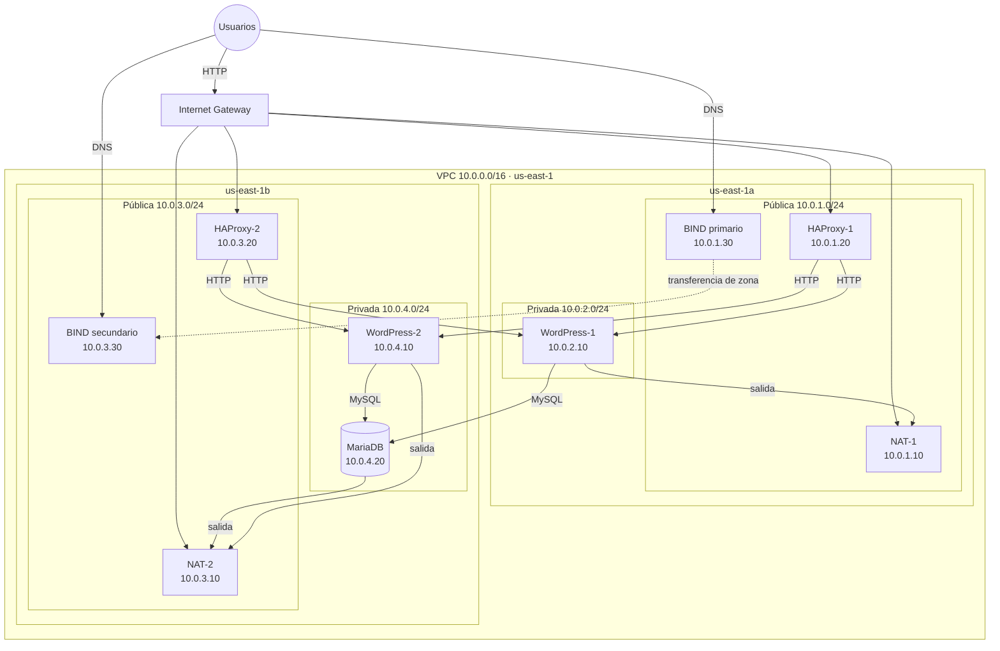
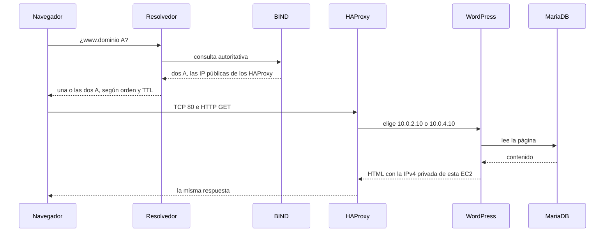
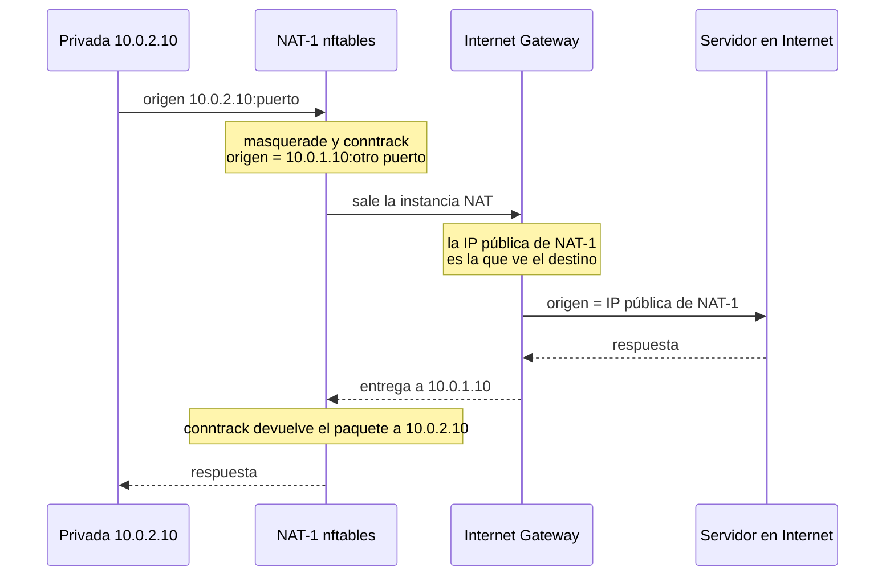

# Diagramas de arquitectura

Estos dibujos describen el diseño del repositorio. Para el PDF de la entrega hay que exportarlos a imagen (captura de un visor de Mermaid, draw.io o la herramienta que usen) y numerarlos como figuras.

Todavía no hay una consola de AWS que fotografiar. Esas capturas salen el día que la VPC esté creada.

## Diagrama de arquitectura AWS (draw.io)

El archivo [`arquitectura-aws.drawio`](arquitectura-aws.drawio) contiene el diagrama de arquitectura con los iconos oficiales de AWS, listo para editar y exportar.

**Cómo abrirlo y exportarlo:**

1. Entra a [app.diagrams.net](https://app.diagrams.net) (draw.io).
2. `File → Open from → Device` y elige `arquitectura-aws.drawio`. También se puede importar desde GitHub con `File → Open from → GitHub`.
3. Para la figura del documento: `File → Export as → PNG` (o SVG/PDF), con fondo transparente o blanco.

**Qué muestra:**

- VPC `10.0.0.0/16` con las dos AZ (`us-east-1a` y `us-east-1b`).
- Las 4 subredes (2 públicas, 2 privadas) y las 9 instancias EC2 con su IP.
- Flujos: DNS `:53` (Round Robin a los dos BIND9), HTTP `:80` (Internet Gateway → HAProxy → WordPress, balanceo cruzado), MySQL `:3306` (WordPress → MariaDB).
- Salida a Internet de cada subred privada por la instancia NAT de su misma AZ.
- Transferencia de zona del BIND9 primario al secundario.

## Figura. Vista lógica de las 9 EC2



El tráfico HTTP entre un HAProxy y una WordPress, y el tráfico MySQL entre WordPress y MariaDB, usan la ruta local `10.0.0.0/16`. No pasan por el NAT.

## Figura. Petición de un visitante



## Figura. Salida a Internet desde una privada

Hay dos traducciones, una detrás de la otra.



## Vista en texto, por si el visor no dibuja Mermaid

```
Internet
   |
   |  Internet Gateway
   |
   +-- us-east-1a
   |     Pública 10.0.1.0/24:  NAT-1 .10   HAProxy-1 .20   BIND primario .30
   |     Privada 10.0.2.0/24:  WordPress-1 .10
   |     La privada 1 sale por NAT-1
   |
   +-- us-east-1b
         Pública 10.0.3.0/24:  NAT-2 .10   HAProxy-2 .20   BIND secundario .30
         Privada 10.0.4.0/24:  WordPress-2 .10   MariaDB .20
         La privada 2 sale por NAT-2

HAProxy-1 y HAProxy-2 hablan con las dos WordPress.
Las dos WordPress hablan con MariaDB.
BIND primario transfiere la zona a BIND secundario.
```
