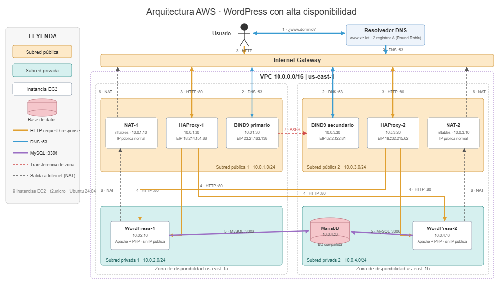
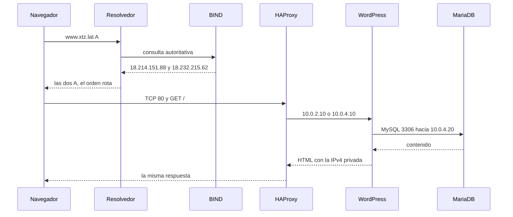
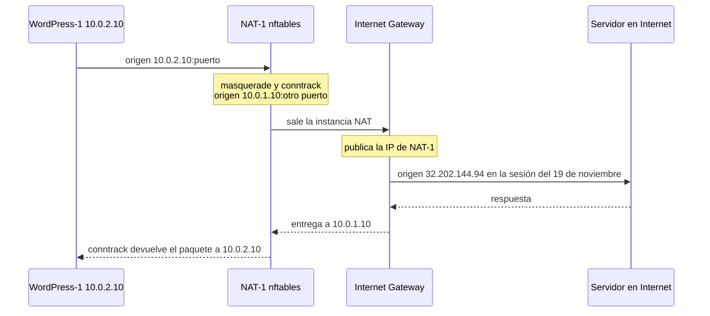
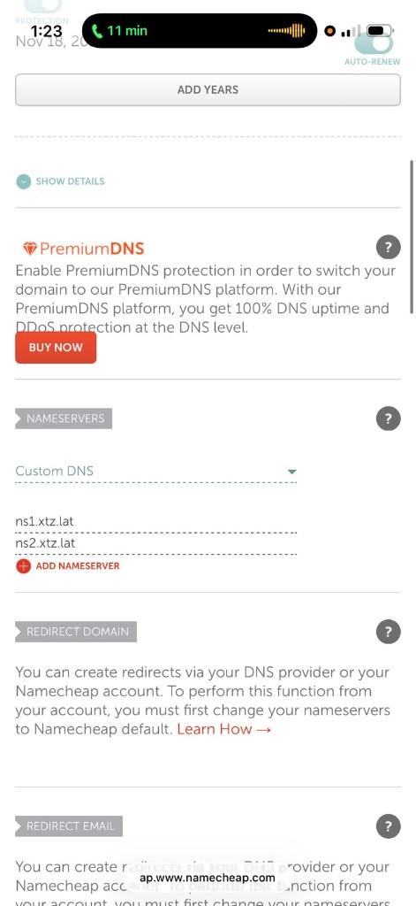

# Despliegue del sitio web de XYZ S.A. sobre AWS

Documento del Proyecto N2, SI3002. Las capturas de las pruebas están tomadas. Este archivo es el texto que va en el Word, junto a esas fotos y al diagrama de `diagramas/arquitectura-aws.svg`.

Universidad EAFIT. Curso SI3002, Despliegue de Aplicaciones y Servicios en Red. Entrega: 20 de noviembre de 2026, plataforma interactiva virtual.

---

## Página de presentación

**Título:** Despliegue del sitio web de XYZ S.A. sobre una infraestructura de red en AWS, con alta disponibilidad y escalado horizontal.

**Curso:** SI3002 — Despliegue de Aplicaciones y Servicios en Red.

**Estudiantes:**

- Juan José Palacio
- Alejandro Correa
- Samuel Granados

**Fecha:** 20 de noviembre de 2026.

**Sitio publicado:** http://www.xtz.lat

**Cuenta y región:** AWS Academy Learner Lab, `us-east-1`.

---

## Tabla de contenido

1. Introducción
2. Arquitectura, implementación y despliegue
   - 2.1 Direccionamiento
   - 2.2 Inventario
   - 2.3 Rutas y flujos
   - 2.4 Controles de tráfico y administración
   - 2.5 NAT
   - 2.6 Aplicación web y estado compartido
   - 2.7 Balanceo HTTP
   - 2.8 DNS y delegación
   - 2.9 Orden de despliegue
   - 2.10 Pruebas y análisis de protocolos
3. Aspectos encontrados, resolución y recomendaciones
4. Conclusiones
5. Referencias

En Word, esta lista se genera con los estilos Título 1, Título 2 y Título 3. No se deja escrita a mano en el PDF final.

## Lista de figuras

1. Arquitectura de la VPC, las cuatro subredes y las nueve EC2. Dibujo en `diagramas/arquitectura-aws.svg`.
2. Recorrido de una petición a `http://www.xtz.lat`.
3. Las dos traducciones de una salida desde una subred privada.
4. Consola de EC2 con las nueve instancias en `running`.
5. Source/Destination Check desactivado en NAT-1 y NAT-2.
6. Navegador en `http://www.xtz.lat` con el banner `10.0.2.10`.
7. Segunda carga del home, con el banner `10.0.4.10` (B1).
8. Terminal de WordPress-1: IP privada `10.0.2.10` y salida por `32.202.144.94` (N1, 19 de noviembre).
9. `conntrack` en NAT-1, con origen `10.0.2.10` y respuesta hacia `10.0.1.10` (N2).
10. `ip_forward` en 0, intentos con `codigo:000`, y salida recuperada en `32.202.144.94` (N3).
11. `dig` de SOA, NS, A y CNAME contra los dos BIND, y `dig xtz.lat NS` sin `@` (D1).
12. Mismo serial `2026111802` y `prueba.xtz.lat` en `10.9.9.9` en primario y secundario (D2).
13. Primario detenido (`connection refused`) y secundario respondiendo (D3).
14. Varias consultas a `www.xtz.lat` con el orden de las dos A rotando (D4).
15. `dig` de `www` mientras HAProxy-2 está apagado y su A sigue anunciada (D5).
16. Captura de tráfico DNS, UDP puerto 53, pregunta `A? www.xtz.lat`.
17. Saludo TCP de tres vías: `Flags [S]`, `[S.]` y `[.]` entre `10.0.1.20` y `10.0.2.10`.
18. Captura HTTP del `GET /`, respuesta `200` y banner `10.0.2.10`.
19. N4: salida desde WordPress-1 aceptada, y dos intentos desde fuera sin página.
20. B2: Apache de WordPress-2 detenido y los dos HAProxy respondiendo solo con `10.0.2.10`.
21. Namecheap con Custom DNS en `ns1.xtz.lat` y `ns2.xtz.lat`.
22. Sesión de Session Manager abierta en WordPress-1, sin SSH.

## Lista de tablas

1. Subredes.
2. Inventario de las nueve EC2.
3. Rutas.
4. Entrada de los security groups.
5. Registros de la zona `xtz.lat`.
6. Estado compartido.
7. DNS Round Robin y HAProxy.
8. Resultados de las once pruebas.

En Word, esta lista se genera desde los títulos de las tablas. Los números de abajo ya coinciden con ese orden.

---

## 1. Introducción

XYZ S.A. es una compañía de cosméticos con presencia en América Latina. Para entrar al mercado colombiano definió sedes en Medellín, Bogotá y Bucaramanga. El centro de datos de la sede principal queda en Medellín, donde siguen aplicaciones de la operación propia. El sitio público, con la información de la empresa y de sus productos, se desplegó en la nube para atender varios visitantes a la vez y poder crecer agregando servidores web.

El equipo diseñó e implementó ese sitio con WordPress sobre Amazon Web Services. La red es una VPC IPv4 en dos zonas de disponibilidad. La salida a Internet de las subredes privadas, el balanceo HTTP y el DNS autoritativo los implementó el equipo sobre EC2 con Ubuntu 24.04. El servicio publicado es `http://www.xtz.lat`. El tope del enunciado es de nueve EC2 simultáneas, y el despliegue usa exactamente esas nueve.

Este documento registra el direccionamiento, las rutas, los flujos, el inventario, la configuración de cada servicio y las pruebas hechas el 18 y el 19 de noviembre de 2026. Las once pruebas y las capturas de DNS, TCP y HTTP quedaron medidas. La sección 2.10 recoge el resultado de cada una.

---

## 2. Arquitectura, implementación y despliegue

### 2.1 Direccionamiento

La VPC usa el bloque privado `10.0.0.0/16` [8]. Hay cuatro subredes `/24`. Cada zona de disponibilidad tiene una subred pública y una privada.

**Tabla 1. Subredes**

| Subred | CIDR | Zona | Uso |
|---|---|---|---|
| Pública 1 | 10.0.1.0/24 | us-east-1a | NAT-1, HAProxy-1, BIND primario |
| Privada 1 | 10.0.2.0/24 | us-east-1a | WordPress-1 |
| Pública 2 | 10.0.3.0/24 | us-east-1b | NAT-2, HAProxy-2, BIND secundario |
| Privada 2 | 10.0.4.0/24 | us-east-1b | WordPress-2 y MariaDB |

Las direcciones `10.0.0.0/8` no se anuncian en Internet [8]. Por eso una instancia de una subred privada no puede ser el destino de una conexión que nace afuera. Su salida, cuando hace falta, pasa por el NAT de su misma zona.

### 2.2 Inventario

Las nueve instancias usan Ubuntu Server 24.04 LTS y el tipo `t2.micro` (1 vCPU y 1 GB de RAM cada una). El laboratorio de esta cuenta limita a la vez la cantidad de instancias y los vCPU. Con nueve `t2.micro` el despliegue cabe. Las tres máquinas de las subredes privadas no tienen dirección pública.

Las direcciones que aparecen en el DNS son Elastic IP. Siguen asociadas a la misma instancia aunque el laboratorio detenga y vuelva a encender las máquinas. Los dos NAT usan la IP pública automática de la cuenta. Esa dirección puede cambiar entre sesiones y no está escrita en la zona.

**Tabla 2. Nueve EC2**

| Nombre | IP privada | IP pública | Subred | Rol |
|---|---|---|---|---|
| NAT-1 | 10.0.1.10 | automática, no fija | Pública 1 | NAT de la zona A |
| HAProxy-1 | 10.0.1.20 | 18.214.151.88 | Pública 1 | Balanceo HTTP |
| BIND primario | 10.0.1.30 | 23.21.163.138 | Pública 1 | DNS autoritativo primario, ns1 |
| WordPress-1 | 10.0.2.10 | ninguna | Privada 1 | WordPress, Apache y PHP |
| NAT-2 | 10.0.3.10 | automática, no fija | Pública 2 | NAT de la zona B |
| HAProxy-2 | 10.0.3.20 | 18.232.215.62 | Pública 2 | Balanceo HTTP |
| BIND secundario | 10.0.3.30 | 52.2.122.81 | Pública 2 | DNS autoritativo secundario, ns2 |
| WordPress-2 | 10.0.4.10 | ninguna | Privada 2 | WordPress, Apache y PHP |
| MariaDB | 10.0.4.20 | ninguna | Privada 2 | Base única |

**Figura 4.** Consola con las nueve instancias en ejecución.

**Figura 1.** Arquitectura medida. El dibujo está en `diagramas/arquitectura-aws.svg` y en `docs/documento-final/figuras/figura-1-arquitectura.png`.

Identificadores de instancia leídos en la consola:

| Nombre | Identificador |
|---|---|
| NAT-1 | `i-005a8ca73da8cf12c` |
| HAProxy-1 | `i-085069329cce3c5f8` |
| BIND primario | `i-0c98f165c61010837` |
| WordPress-1 | `i-09619c20535ee8124` |
| NAT-2 | `i-0a3a0321bfd6d027f3` |
| HAProxy-2 | `i-0acda054ec96fe4c0` |
| BIND secundario | `i-0a5c92c94566f29fc` |
| WordPress-2 | `i-0db961a558004ae9e` |
| MariaDB | `i-03bf79f5879602ed2` |

WordPress-1 se volvió a ver el 19 de noviembre en Session Manager con `i-09619c20535ee8124`. Los identificadores `vpc-…` y `rtb-…` no quedaron en una captura, así que no se inventan aquí.

### 2.3 Rutas y flujos

Cada tabla de rutas incluye la ruta local `10.0.0.0/16`, creada por la VPC. El equipo agregó la ruta por defecto.

**Tabla 3. Rutas**

| Tabla | Subredes | Ruta por defecto |
|---|---|---|
| Pública | 10.0.1.0/24 y 10.0.3.0/24 | 0.0.0.0/0 hacia el Internet Gateway |
| Privada de la zona A | 10.0.2.0/24 | 0.0.0.0/0 hacia la instancia NAT-1 |
| Privada de la zona B | 10.0.4.0/24 | 0.0.0.0/0 hacia la instancia NAT-2 |

En WordPress-1, `ip route` muestra `default via 10.0.2.1`. `10.0.2.1` es el router de esa subred dentro de la VPC. La tabla de rutas asociada a la subred es la que envía `0.0.0.0/0` a NAT-1. La instancia no tiene una ruta estática directa hacia `10.0.1.10`.

El tráfico entre un HAProxy y una WordPress, y entre WordPress y MariaDB, usa la ruta local. No sale de la VPC y no pasa por el NAT. El NAT entra cuando el destino está fuera de `10.0.0.0/16`: instalación de paquetes, registro de Session Manager de las privadas y la prueba de salida a Internet.

Una visita a `http://www.xtz.lat` recorre cuatro protocolos:

1. DNS, casi siempre UDP al puerto 53. El nombre `www.xtz.lat` se resuelve a `18.214.151.88` y `18.232.215.62` [6], [7].
2. TCP al puerto 80 de una de esas dos direcciones. El saludo es SYN, SYN-ACK y ACK [4]. Esa conexión termina en HAProxy.
3. HTTP. HAProxy abre una segunda conexión TCP hacia `10.0.2.10` o `10.0.4.10` y reenvía el `GET /` [5].
4. MySQL, TCP 3306, desde esa WordPress hasta `10.0.4.20`, por la ruta local de la VPC.

**Figura 2.** Recorrido de una petición.

### 2.4 Controles de tráfico y administración

Los security groups permiten solo el tráfico que el diseño usa. La salida queda abierta. Como el security group de AWS tiene estado, la respuesta de una conexión iniciada desde la instancia puede volver. El puerto 22 no está publicado. Las listas de control de red se dejaron en su permiso por defecto.

**Tabla 4. Entrada de los security groups**

| Grupo | Entrada permitida |
|---|---|
| NAT-1 | Todo desde 10.0.2.0/24. ICMP desde 10.0.0.0/16 |
| NAT-2 | Todo desde 10.0.4.0/24. ICMP desde 10.0.0.0/16 |
| HAProxy | TCP 80 desde Internet. ICMP desde 10.0.0.0/16 |
| BIND | TCP 53 y UDP 53 desde Internet. ICMP desde 10.0.0.0/16 |
| WordPress | TCP 80 solo desde 10.0.1.20 y 10.0.3.20 |
| MariaDB | TCP 3306 solo desde 10.0.2.10 y 10.0.4.10 |

La administración se hace con AWS Systems Manager Session Manager y el perfil de instancia del laboratorio. No hay bastión. Las instancias privadas alcanzan el servicio de sesiones saliendo por el NAT de su zona. **Figura 22.** Sesión abierta sobre WordPress-1 (`i-09619c20535ee8124`). La barra de la consola muestra el identificador de sesión y el de la instancia. La entrada no es SSH: el puerto 22 no está publicado.

### 2.5 NAT

Cada NAT es una EC2 con Ubuntu 24.04. El equipo activó el reenvío de IP y configuró nftables. No se usó NAT Gateway ni una imagen preparada como NAT.

`net.ipv4.ip_forward=1` queda también en `/etc/sysctl.d/99-nat.conf`, así que un reinicio no lo borra. En postrouting, nftables enmascara el tráfico cuyo origen es la privada de esa zona y que sale por la interfaz de la instancia. NAT-1 enmascara `10.0.2.0/24`. NAT-2 enmascara `10.0.4.0/24`. Las reglas se guardan en `/etc/nftables.conf`. El paquete `conntrack` permite leer la asociación de direcciones y puertos.

En la consola, Source/Destination Check de NAT-1 y NAT-2 quedó desactivado. Con el chequeo activo, la plataforma descarta un paquete cuyo origen o destino no es la propia instancia. Un NAT reenvía tráfico de otras máquinas, así que ese descarte impediría el servicio. **Figura 5.** Las dos interfaces, NAT-1 y NAT-2, muestran la comprobación de origen y destino en desactivado.

Una salida desde WordPress-1 sufre dos traducciones seguidas.

1. nftables en NAT-1 cambia el origen `10.0.2.10:puerto` por `10.0.1.10` y un puerto de la tabla de conexiones. conntrack guarda la pareja para devolver la respuesta [9]. Esta traducción la hizo el equipo.
2. El Internet Gateway presenta la IP privada de NAT-1 como la IP pública de esa instancia. El gateway no ve `10.0.2.10`. Para él, el cliente es NAT-1.

**Figura 3.** Las dos traducciones.

No hay una regla de destino (DNAT). Una conexión nueva que llega a la IP pública del NAT no tiene una entrada previa en conntrack y no se reenvía a la privada. La privada tampoco tiene IP pública, y su security group solo acepta HTTP desde los dos HAProxy.

### 2.6 Aplicación web y estado compartido

El sitio es WordPress sobre Apache y PHP, una instancia en cada subred privada. MariaDB está solo en `10.0.4.20`, escucha en el puerto 3306 y el usuario de la aplicación existe solo para `10.0.2.10` y `10.0.4.10`.

La instalación del sitio se ejecutó una vez, en WordPress-1. WordPress-2 usa la misma base y las mismas salts de `wp-config.php`, y no vuelve a correr el instalador. Las páginas describen la empresa, las sedes de Medellín, Bogotá y Bucaramanga, y las líneas de producto. Ese texto vive en la base. La dirección del sitio es `http://www.xtz.lat`.

En cada respuesta HTML, un complemento de carga obligatoria imprime la IPv4 privada de la EC2 que generó esa respuesta. La lee de la dirección local del servidor en esa petición. Apache y el complemento envían `Cache-Control: no-store`. No hay un plugin de caché de página. La redirección canónica de WordPress está desactivada para que una petición a la IP de un balanceador no salte al otro por el nombre DNS.

**Tabla 6. Estado compartido**

| Elemento | Dónde está | Consecuencia |
|---|---|---|
| Páginas, usuarios y opciones | MariaDB | Las dos WordPress muestran el mismo sitio |
| Código, tema y complemento de la IP | Disco de cada EC2 | Se instaló en las dos y tiene que quedar igual |
| `wp-content/uploads` | Disco de la EC2 donde se subió el archivo | No se comparte. El sitio de la demostración no depende de imágenes subidas |
| MariaDB | Una sola EC2, en la zona B | Si esa instancia se apaga, las dos WordPress dejan de poder construir la página |

La base única es un punto único de falla. El enunciado pide una sola EC2 de base de datos y un máximo de nueve instancias, así que no se agregó una réplica.

**Figura 6.** Home de `http://www.xtz.lat` con el banner `10.0.2.10`. **Figura 7.** Otra carga del mismo home, con el banner `10.0.4.10`. El texto de la página es el mismo. Cambia la IP privada porque cada respuesta la armó una WordPress distinta.

### 2.7 Balanceo HTTP

Hay un HAProxy en cada subred pública. Los dos archivos de configuración son iguales: round-robin entre `10.0.2.10:80` y `10.0.4.10:80`, chequeo HTTP cada 3 segundos, dos fallos para marcar el backend como caído, reintento hacia el otro backend y cierre de la conexión hacia el servidor al terminar cada petición. No hay cookie de afinidad.

Ese cierre importa para la demostración. Con una conexión persistente hacia el mismo Apache, varias peticiones seguidas mostrarían siempre la misma IP privada. El banner, sin caché y sin afinidad, identifica qué instancia atendió cada solicitud.

**Tabla 7. DNS Round Robin y HAProxy**

| | DNS Round Robin | HAProxy |
|---|---|---|
| Qué reparte | El nombre `www.xtz.lat`, con dos registros A | Cada petición HTTP entre las dos WordPress |
| Quién decide | El resolvedor y su caché, durante el TTL | El balanceador, en cada petición |
| Reparto | El orden de las dos A rota. El cliente suele usar la primera | Turna entre los backends que pasan el chequeo |
| Si un nodo se apaga | El registro A sigue publicado. Lo mostró D5 | El chequeo deja de enviar tráfico al backend que no responde. Lo mostró B2: las ocho respuestas fueron `10.0.2.10` |
| Qué mide | Resolución de nombres. No mide conexiones HTTP | Qué WordPress generó cada respuesta |

Round Robin elige a cuál de los dos HAProxy llega el cliente. HAProxy elige cuál WordPress responde. El TTL de la zona es de 60 segundos para poder observar la caché durante la sustentación. En operación, ese valor sería mayor.

### 2.8 DNS y delegación

El dominio es `xtz.lat`, registrado en Namecheap. Los servidores de nombres del registrador quedaron en `ns1.xtz.lat` (`23.21.163.138`) y `ns2.xtz.lat` (`52.2.122.81`), con la dirección IP escrita junto al nombre (glue). Una consulta pública `dig xtz.lat NS`, sin indicar un servidor con `@`, devolvió esos dos nombres. La delegación está activa.

BIND9 corre en las dos subredes públicas, con recursión desactivada. El primario guarda la zona en `/etc/bind/zones/db.xtz.lat`. El secundario la recibe por transferencia hacia `10.0.3.30` y la escribe en `/var/cache/bind`. `allow-transfer` del primario incluye solo esa dirección. El aviso de cambio es un NOTIFY. La transferencia usa TCP en el puerto 53.

**Tabla 5. Registros de `xtz.lat`**

| Nombre | Tipo | Valor medido |
|---|---|---|
| xtz.lat | SOA | ns1.xtz.lat, hostmaster.xtz.lat, TTL 60. Serial inicial 2026111801. Después de D2, 2026111802 |
| xtz.lat | NS | ns1.xtz.lat y ns2.xtz.lat |
| ns1 | A | 23.21.163.138 |
| ns2 | A | 52.2.122.81 |
| xtz.lat y www | A | 18.214.151.88 y 18.232.215.62 |
| inicio | CNAME | www.xtz.lat |
| prueba | A | 10.9.9.9, agregado solo para D2. Conviene quitarlo y subir el serial antes de la entrega |

**Figura 21.** Namecheap, dominio `xtz.lat`, Nameservers en Custom DNS, con `ns1.xtz.lat` y `ns2.xtz.lat`.

### 2.9 Orden de despliegue

El orden siguió las dependencias de red.

1. VPC, subredes, Internet Gateway, tablas de rutas y security groups.
2. Lanzamiento de las nueve EC2, desactivación de Source/Destination Check en los NAT y ruta por defecto de cada privada hacia el NAT de su zona.
3. Elastic IP en los dos HAProxy y los dos BIND.
4. nftables y reenvío de IP en NAT-1 y en NAT-2. Hasta este paso las privadas no instalan paquetes.
5. MariaDB, luego WordPress-1 y después WordPress-2.
6. HAProxy en las dos subredes públicas.
7. Zona en el BIND primario, transferencia al secundario y delegación en Namecheap.
8. Cambio de la dirección del sitio a `http://www.xtz.lat` y pruebas del 18 y 19 de noviembre.

### 2.10 Pruebas y análisis de protocolos

Cada prueba incluye el procedimiento, el resultado medido, la lectura y los protocolos. Las figuras están tomadas en la terminal o en la consola donde se ejecutó el comando, el 18 y el 19 de noviembre de 2026.

**Tabla 8. Resultados**

| Prueba | Resultado medido | Figura |
|---|---|---|
| N1 | WordPress-1 solo tiene `10.0.2.10`. La ruta es `default via 10.0.2.1`. El 18 de noviembre `ifconfig.me` devolvió `13.220.34.110`. La captura del 19 de noviembre devolvió `32.202.144.94`, la IP pública de NAT-1 en esa sesión | 8 |
| N2 | En NAT-1, conntrack mostró `src=10.0.2.10` hacia el puerto 443 y la respuesta dirigida a `dst=10.0.1.10`. El 18 de noviembre el puerto de origen fue `34726`. El 19 de noviembre se repitió el mismo par de tuplas, con estados `SYN_RECV` y `ESTABLISHED` | 9 |
| N3 | Con `ip_forward=0`, los intentos `t3` a `t9` devolvieron `codigo:000` y ninguna IP. Al volver a 1, `t10` a `t12` devolvieron `32.202.144.94` y `codigo:200` | 10 |
| N4 | Desde WordPress-1, `ifconfig.me` devolvió `32.202.144.94`. Desde el computador del equipo, `http://32.202.144.94/` y `http://10.0.2.10/` no devolvieron la página | 19 |
| D1 | Los dos BIND respondieron SOA, NS, las dos A de `www` y el CNAME `inicio`. `dig xtz.lat NS` sin `@` devolvió `ns1` y `ns2`. La captura del 19 de noviembre ya muestra el serial `2026111802`, porque D2 se había ejecutado | 11 |
| D2 | El serial pasó a `2026111802` y se agregó `prueba.xtz.lat A 10.9.9.9`. Primario y secundario devolvieron el mismo serial y `10.9.9.9` | 12 |
| D3 | Con `named` detenido, el primario respondió `connection refused`. El secundario siguió entregando el SOA `2026111802` y las dos A de `www`. Luego se volvió a iniciar el primario | 13 |
| D4 | Consultas seguidas a `23.21.163.138` rotaron el orden de `18.214.151.88` y `18.232.215.62`. `8.8.8.8` también devolvió las dos direcciones | 14 |
| D5 | Con HAProxy-2 apagado, el autoritativo siguió anunciando `18.232.215.62` y `18.214.151.88`. La instancia se volvió a encender. La Elastic IP no cambió | 15 |
| B1 | El navegador mostró el banner `10.0.2.10` y, en otra carga, `10.0.4.10` | 6 y 7 |
| B2 | Con `apache2` detenido en WordPress-2, cuatro peticiones a HAProxy-1 y cuatro a HAProxy-2 devolvieron solo `10.0.2.10`. Después se inició de nuevo Apache | 20 |

**N1.** Desde WordPress-1, por Session Manager, se leyó la IP privada, la ruta y la dirección que ve un servidor externo. La máquina solo tiene `10.0.2.10`. La ruta es `default via 10.0.2.1 dev enX0`. El 19 de noviembre `ifconfig.me` devolvió `32.202.144.94`. El 18 de noviembre, en la misma prueba, había devuelto `13.220.34.110`. Las dos son la IP pública automática de NAT-1. El protocolo de la prueba es IP, con reescritura del origen [2], [9], transportado en TCP con TLS. El Internet Gateway publica la IP de NAT-1. No publica la de WordPress-1.

**N2.** En NAT-1, `conntrack -E -p tcp` mientras WordPress-1 abría HTTPS hacia Internet. El 18 de noviembre una línea fue `src=10.0.2.10 dst=13.217.79.194 sport=34726 dport=443` en la ida, y `dst=10.0.1.10 dport=34726` en la vuelta. El 19 de noviembre el mismo patrón se repitió con otros destinos del puerto 443: la ida sale de `10.0.2.10` y la vuelta llega a `10.0.1.10`, con estados `SYN_RECV` y `ESTABLISHED`.

La primera tupla es el paquete que sale de la privada. La segunda es la traducción: la respuesta vuelve a NAT-1, que conntrack asocia con `10.0.2.10`. El puerto de origen distingue esa conexión de otras [4], [9]. NAT-1 atiende `10.0.2.0/24`. NAT-2 atiende `10.0.4.0/24`, porque cada tabla de rutas apunta a un NAT distinto.

**N3.** En NAT-1 se ejecutó `sysctl -w net.ipv4.ip_forward=0` mientras WordPress-1 repetía `curl` hacia `ifconfig.me`. Los intentos `t1` y `t2` todavía devolvieron `32.202.144.94` con `codigo:200`. De `t3` a `t9` el resultado fue `codigo:000`, sin dirección. Tras `sysctl -w net.ipv4.ip_forward=1`, `t10` a `t12` volvieron a `32.202.144.94` con `codigo:200`. El núcleo, con el reenvío apagado, no pasa a la interfaz de salida un datagrama que no es para él [2]. Las reglas de nftables no se aplican a un paquete que el sistema no reenvía. Al apagar el reenvío, la sesión de Session Manager de WordPress-1 también se congela, porque esa sesión sale por el mismo NAT.

**N4.** Desde WordPress-1, `curl` a `ifconfig.me` devolvió `32.202.144.94`: la salida iniciada en la privada sí se completa. Desde el computador del equipo, fuera de la VPC, `curl` a `http://32.202.144.94/` y a `http://10.0.2.10/` no obtuvo la página. La privada no es enrutable desde Internet [8]. El NAT no tiene DNAT, así que una conexión nueva hacia su IP pública no se reenvía a WordPress. El security group de WordPress tampoco acepta ese origen.

**D1.** Consultas directas a `23.21.163.138` y a `52.2.122.81`, más `dig xtz.lat NS` sin servidor fijo. Los dos autoritativos devolvieron el mismo SOA. `www` tiene dos A. `inicio.xtz.lat` es un CNAME de `www.xtz.lat`. La consulta sin `@` demuestra la delegación pública, no solo que el BIND responde si se le pregunta por su IP. El transporte de estas consultas es DNS sobre UDP/53 [6], [7].

**D2.** En el primario se subió el serial de `2026111801` a `2026111802`, se agregó `prueba A 10.9.9.9` y se ejecutó `rndc reload xtz.lat`. El secundario, sin editar el archivo, mostró el serial nuevo y `10.9.9.9`. El serial es la señal de que hay una versión nueva. El primario avisa con NOTIFY y la copia viaja por TCP/53.

**D3.** `systemctl stop named` en el primario. `dig @10.0.1.30` devolvió `connection refused`: no había proceso escuchando en el puerto 53. `dig @10.0.3.30` siguió devolviendo el SOA y las dos A de `www`. Después se inició de nuevo el primario. Un resolvedor público podría seguir contestando desde su caché aunque un autoritativo esté caído, hasta que venza el TTL. Por eso la prueba consulta al secundario directamente.

**D4.** Seis consultas seguidas a `@23.21.163.138 www.xtz.lat A` devolvieron las dos direcciones y fueron alternando cuál aparecía primero. Tres consultas a `@8.8.8.8` también devolvieron las dos. El TTL de la zona es 60 segundos. Un cliente suele usar la primera dirección de la lista que le entrega su resolvedor, y ese orden puede quedar fijo mientras la caché vive. Ver las dos A no cuenta cuántas conexiones HTTP entraron a cada HAProxy.

**D5.** Se detuvo la instancia HAProxy-2. `dig @23.21.163.138 www.xtz.lat A` siguió devolviendo `18.232.215.62` y `18.214.151.88`. BIND entrega la zona que tiene. No consulta el estado del puerto 80. Se volvió a iniciar la instancia. Como esa dirección es Elastic IP, al encender siguió siendo `18.232.215.62`.

**B1.** El navegador en `http://www.xtz.lat` mostró el banner `10.0.2.10` y, al recargar, `10.0.4.10`. El reparto es HTTP sobre dos conexiones TCP: la del cliente hacia el balanceador y la del balanceador hacia Apache.

**B2.** Se detuvo `apache2` en WordPress-2 y se esperó el chequeo, que corre cada 3 segundos y saca el backend al segundo fallo. Cuatro peticiones a HAProxy-1 (`127.0.0.1`) y cuatro a HAProxy-2 (`18.232.215.62`) devolvieron solo `10.0.2.10`. Los dos balanceadores siguieron sirviendo la WordPress que seguía encendida. Después se ejecutó `systemctl start apache2` en WordPress-2.

**Análisis de tráfico.** Las capturas con `tcpdump` se hicieron el 19 de noviembre en la interfaz `enX0`.

- DNS, figura 16. En BIND primario, una consulta UDP (protocolo 17) al puerto 53 llegó desde `10.0.1.20` con la pregunta `A? www.xtz.lat`. La respuesta trajo `18.214.151.88`, `18.232.215.62`, `ns1` y `ns2` [6], [7].
- TCP, figura 17. Entre HAProxy-1 (`10.0.1.20.55552`) y WordPress-1 (`10.0.2.10.80`) se vieron `Flags [S]`, `Flags [S.]` y `Flags [.]`. El SYN usó la secuencia `1199633676` y el SYN-ACK confirmó `1199633677` [4].
- HTTP, figura 18. En esa misma conexión el texto del paquete contiene `GET / HTTP/1.1`, `HTTP/1.1 200 OK` y el banner `IPv4 privada: 10.0.2.10` [5].
- IP. WordPress-1 solo tiene `10.0.2.10`. La ruta por defecto sale por el router `10.0.2.1`. El destino externo ve la IP pública del NAT [2], [8]. N2 muestra la traducción en conntrack.
- ICMP. Los security groups permiten echo dentro de `10.0.0.0/16`. No se guardó una captura aparte de echo request y echo reply. El resto de los protocolos pedidos sí quedó en las figuras 16, 17 y 18 y en N1 a N3.

---

## 3. Aspectos encontrados, resolución y recomendaciones

1. **La cuota del laboratorio no alcanzaba para los tipos del primer diseño.** El plan inicial usaba `t3.micro` y `t3.small` (2 vCPU cada uno). La cuenta limita las instancias simultáneas y los vCPU. Se pasó todo el inventario a `t2.micro`. Las nueve máquinas entran. WordPress y MariaDB quedan justos de memoria, y alcanzan para la demostración.

2. **La IP pública de los NAT cambia entre sesiones.** En N1, el 18 de noviembre, Internet vio `13.220.34.110`. En N3, el 19, vio `32.202.144.94`. Los NAT no tienen Elastic IP. La ruta de la privada apunta a `10.0.1.10` o `10.0.3.10`, que sí son fijas, así que el servicio sigue. Esas IP públicas no están en la zona DNS.

3. **Las cuatro direcciones del dominio sí se fijaron.** HAProxy-1, HAProxy-2, ns1 y ns2 tienen Elastic IP. Apagar el laboratorio no obliga a reescribir la zona ni la delegación de Namecheap. El laboratorio se detiene solo a las pocas horas. El día de la sustentación hay que encenderlo y esperar las nueve instancias en `running` antes de abrir el sitio.

4. **Las privadas no salen a Internet hasta que el NAT está completo.** Hacen falta, a la vez, la ruta `0.0.0.0/0`, Source/Destination Check apagado, `ip_forward=1` y la regla de masquerade. Sin eso no se instalan paquetes y Session Manager no registra la instancia. El orden de la sección 2.9 salió de ese hecho. N3 lo volvió a mostrar al apagar solo el reenvío.

5. **WordPress necesitó dos ajustes de instalación.** El paquete de idioma `es_ES` no estuvo disponible en el primer intento y la instalación siguió en inglés para cargar el idioma después. WP-CLI no crea páginas si falta el cliente de MariaDB. Se instaló `mariadb-client` y las páginas quedaron en la base.

6. **La base es un solo punto de falla.** Si se apaga `10.0.4.20`, los balanceadores y una WordPress pueden seguir encendidos y el sitio deja de armarse. Una réplica en la otra zona sería el paso siguiente. Hoy no cabe: el enunciado pide una sola EC2 de base y el tope es de nueve instancias.

7. **Los archivos subidos no se comparten.** `wp-content/uploads` queda en el disco de la EC2 donde se cargó el archivo. El sitio de la demostración usa el texto de la base y no depende de una imagen.

8. **DNS Round Robin no retira un balanceador caído.** D5 lo mostró: con HAProxy-2 apagado, `18.232.215.62` siguió en la respuesta. El TTL de 60 segundos sirve para el laboratorio. En operación debería ser mayor. Un chequeo de salud delante del DNS quedaría fuera de este enunciado, porque el DNS autoritativo tiene que ser BIND administrado por el equipo.

9. **Quedó un registro de prueba en la zona.** D2 agregó `prueba.xtz.lat A 10.9.9.9` y subió el serial a `2026111802`. Primario y secundario lo responden. Es un registro de laboratorio, no del sitio. Conviene borrarlo en el primario, subir el serial otra vez y comprobar que el secundario recibe la zona limpia.

10. **La captura ICMP de echo no se archivó.** DNS, TCP y HTTP sí quedaron en `tcpdump` (figuras 16, 17 y 18). N4 y B2 también se ejecutaron el 19 de noviembre. Los security groups ya permiten ICMP dentro de la VPC para un echo request y echo reply, y esa captura suelta no se tomó.

---

## 4. Conclusiones

El sitio de XYZ S.A. quedó publicado en `http://www.xtz.lat` sobre nueve EC2 Ubuntu 24.04, en dos zonas de disponibilidad, con el direccionamiento y las rutas de la sección 2.

La salida de las subredes privadas la hace un NAT propio con nftables. El Internet Gateway solo presenta hacia Internet la IP pública de la instancia NAT. N1 mostró que el destino ve esa IP y no `10.0.2.10`. N2 mostró la asociación de conntrack. N3 mostró que, sin reenvío de IP, esa salida se detiene.

`xtz.lat` está delegado en los dos BIND. El secundario recibe la zona cuando sube el serial y sigue respondiendo si el primario se detiene. `www` anuncia las dos Elastic IP de HAProxy. Ese anuncio rota el orden y no deja de publicar una IP cuando el balanceador está apagado.

HAProxy reparte las peticiones HTTP entre `10.0.2.10` y `10.0.4.10`. El banner de la IP privada, sin caché y sin afinidad de sesión, es la evidencia de qué servidor atendió cada respuesta. B1 lo mostró al alternar las dos IP. B2 lo mostró al revés: con WordPress-2 caída, los dos HAProxy respondieron solo con `10.0.2.10`. La base MariaDB es compartida y es un único punto de falla. Los archivos subidos no se comparten.

N4 separó la salida de la entrada. La conexión que nace en la privada llega a Internet con la IP pública del NAT. Una conexión nueva, nacida fuera, no obtiene la página ni por esa IP pública ni por `10.0.2.10`.

---

## Referencias

[1] Enunciado del Proyecto N2, curso SI3002, Despliegue de Aplicaciones y Servicios en Red, 5 de noviembre de 2026.

[2] J. Postel, "Internet Protocol," RFC 791, septiembre de 1981.

[3] J. Postel, "Internet Control Message Protocol," RFC 792, septiembre de 1981.

[4] W. Eddy, Ed., "Transmission Control Protocol (TCP)," RFC 9293, agosto de 2022.

[5] R. Fielding, M. Nottingham y J. Reschke, "HTTP Semantics," RFC 9110, junio de 2022.

[6] P. Mockapetris, "Domain names - concepts and facilities," RFC 1034, noviembre de 1987.

[7] P. Mockapetris, "Domain names - implementation and specification," RFC 1035, noviembre de 1987.

[8] Y. Rekhter, B. Moskowitz, D. Karrenberg, G. J. de Groot y E. Lear, "Address Allocation for Private Internets," RFC 1918, febrero de 1996.

[9] P. Srisuresh y K. Egevang, "Traditional IP Network Address Translator (Traditional NAT)," RFC 3022, enero de 2001.

[10] Amazon Web Services, "What is Amazon VPC?" Amazon VPC User Guide. [En línea]. Disponible: https://docs.aws.amazon.com/vpc/latest/userguide/what-is-amazon-vpc.html. Consultado: 19 de noviembre de 2026.

[11] Amazon Web Services, "AWS Systems Manager Session Manager," AWS Systems Manager User Guide. [En línea]. Disponible: https://docs.aws.amazon.com/systems-manager/latest/userguide/session-manager.html. Consultado: 19 de noviembre de 2026.

[12] The netfilter project, "nftables wiki." [En línea]. Disponible: https://wiki.nftables.org/. Consultado: 19 de noviembre de 2026.

[13] HAProxy Technologies, "HAProxy version 2.8 Configuration Manual." [En línea]. Disponible: https://docs.haproxy.org/2.8/configuration.html. Consultado: 19 de noviembre de 2026.

[14] Internet Systems Consortium, "BIND 9 Administrator Reference Manual." [En línea]. Disponible: https://bind9.readthedocs.io/en/stable/. Consultado: 19 de noviembre de 2026.

[15] WordPress.org, "Requirements." [En línea]. Disponible: https://wordpress.org/about/requirements/. Consultado: 19 de noviembre de 2026.

[16] Canonical, "Ubuntu Server documentation." [En línea]. Disponible: https://ubuntu.com/server/docs. Consultado: 19 de noviembre de 2026.

[17] MariaDB Foundation, "MariaDB Server documentation." [En línea]. Disponible: https://mariadb.com/kb/en/documentation/. Consultado: 19 de noviembre de 2026.
